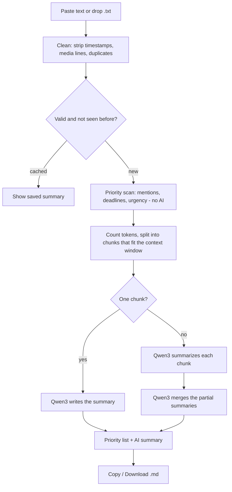

# 📨 ProtocolX: What Did I Miss?

**A local-first AI micro-app that turns a long, unread chat into a short summary: what was decided, what is done, what is still open, and what needs *your* attention.**

Everything runs on your own computer with a small open model (Qwen3-0.6B). Your conversations never leave your device.

---

## 1. The problem

Group chats pile up. After a day away you come back to hundreds of messages and ask: *"What did I miss?"* Reading everything takes too long, but skipping it means missing a decision, a deadline, or a message addressed to you.

ProtocolX answers that question in seconds, without sending a single message to the cloud.

## 2. What it does

| Challenge requirement | How ProtocolX handles it |
|---|---|
| Summarize long and unread conversations | Local Qwen3-0.6B writes a structured summary. Long chats are split at message boundaries, summarized in parts, then merged (map-reduce), so nothing is silently cut off. |
| Identify important messages, decisions, action items | The summary has fixed sections: Overview, Key Information, Decisions Made, Progress, Problems and Unresolved Questions, Action Items. The prompt tells the model not to treat suggestions as decisions. |
| Prioritize by urgency and relevance | Action items are tagged **High / Medium / Low**. A separate rule-based scan scores every message and shows a 🔔 **Needs your attention** list (🔴 High, 🟠 Medium). |
| Highlight mentions, deadlines, tasks the user may have missed | Enter your name and messages about you get flagged. Deadlines ("tomorrow", "Friday 5pm", "by Thursday") and urgent words are detected on every message, so a small model cannot miss them. |
| Local-first processing | The model runs in a separate local process. No API, no cloud, no telemetry, no public link. Temporary files are wiped on exit. |

### More features

- **Paste or drop a file**: paste text, or drop a `.txt` file (a WhatsApp "Export chat" file works; timestamps, media placeholders and the encryption notice are removed automatically).
- **Streaming output**: the priority list appears instantly, then the AI summary types out live.
- **Stop button that really stops**: kills and restarts the model, even in the middle of a long input.
- **Summary length**: short, medium or detailed.
- **Copy and download**: one-click copy, or download as a `.md` file.
- **Instant repeat**: summarizing the same chat with the same options again is answered from memory without running the model.
- **Friendly errors**: missing model, empty input, too-long input and model crashes show a clear message instead of a stack trace.

## 3. How it works



**Context budget.** A model can only read and write a limited number of tokens at once (the *context window*, 4096 by default). That window must hold the instructions, the chat **and** the answer. ProtocolX measures the instructions with the model's own tokenizer, reserves room for the answer, and splits the chat so each part fits.

**Why two kinds of intelligence?** A 0.6B model is fast and private but sometimes overlooks details. So the work is split:

- **Rules (instant, reliable):** mentions, deadlines, urgent words → the 🔔 list.
- **AI (flexible, readable):** overview, decisions, progress, open problems, action items.

**Why a separate model process?** llama.cpp cannot be interrupted once it is busy reading a long prompt. By running the model in its own process (`llm_worker.py`), the Stop button can kill it instantly and start a clean one. It also keeps heavy model memory out of the web server.

## 4. Project structure

```
ProtocolX/
├── ui.py             Gradio web interface (layout, buttons, wiring). No logic.
├── summarizer.py     The pipeline: clean → validate → split → map-reduce → cache
├── highlights.py     Rule-based priority scan (mentions, deadlines, urgency)
├── model_process.py  Starts / talks to / stops the model process (the "backend")
├── llm_worker.py     The model process itself (only file that imports llama_cpp)
├── config.py         All settings and prompts in one place
├── test_core.py      Unit tests (no model needed)
├── requirements.txt  Python dependencies
└── Qwen3-0.6B-Q8_0.gguf   The model file (download it yourself, see below)
```

Layers, from top to bottom: `ui.py` → `summarizer.py` → `model_process.py` → `llm_worker.py`. Each layer only talks to the one below it, so any part can be changed or tested on its own.

## 5. Setup (Windows, PyCharm)

**Requirements:** Python 3.10 or newer, about 1 GB of free RAM, no GPU needed.

1. **Get the code**
   ```
   git clone <your-repo-url>
   cd ProtocolX
   ```
2. **Create a virtual environment and install dependencies**
   ```
   python -m venv env
   env\Scripts\activate
   pip install -r requirements.txt
   ```
   If `llama-cpp-python` fails to build on Windows, install a prebuilt wheel or the Visual Studio C++ Build Tools, then retry.
3. **Download the model.** It is not stored in this repository (GitHub blocks files over 100 MB).
   - Open <https://huggingface.co/Qwen/Qwen3-0.6B-GGUF/tree/main>
   - Download **`Qwen3-0.6B-Q8_0.gguf`** (about 640 MB)
   - Put it in the **same folder as `ui.py`**, or point to it with `PROTOCOLX_MODEL` (see below)
4. **Run**
   ```
   python ui.py
   ```
   The app opens in your browser at <http://127.0.0.1:7860>. The model loads automatically; wait for the status *"Model loaded"*.

## 6. Using the app

1. Paste a conversation (one message per line, `Name: message`) **or** drop a `.txt` file. Try **Load sample chat** first.
2. Optional: type **your name** so messages about you are flagged, and choose a **summary length**.
3. Press **Summarize Conversation**. The 🔔 list appears immediately; the AI summary streams in below it.
4. Use **Copy Summary** or **Download summary (.md)**.
5. Press **Stop** to cancel a long run (the model restarts in a few seconds). **Clear** empties everything and also forgets remembered summaries.

### Getting a WhatsApp chat

WhatsApp does not let other programs read your chats, so use its own export (this stays fully local):

- **Android:** open the chat → ⋮ → More → Export chat → *Without media*
- **iPhone:** open the chat → tap the name → Export Chat → *Without Media*

Copy the `.txt` file to your computer and drop it onto ProtocolX.

## 7. Configuration

Everything lives in `config.py`; these environment variables override the defaults without editing code.

| Variable | Default | Meaning |
|---|---|---|
| `PROTOCOLX_MODEL` | `Qwen3-0.6B-Q8_0.gguf` next to `ui.py` | Full path to the model file |
| `PROTOCOLX_CTX` | `4096` | Context window in tokens. Larger = fewer parts for long chats, more RAM |
| `PROTOCOLX_THREADS` | half your CPU cores | CPU threads for inference |
| `PROTOCOLX_DEBUG` | off | Set to `1` to show the model process' console output when troubleshooting |

Windows example: `set PROTOCOLX_MODEL=D:\models\Qwen3-0.6B-Q8_0.gguf` then `python ui.py`.

## 8. Example

**Input**
```
Riya: Team, demo is on Friday 5pm. We need the drone sim ready by Thursday.
Arjun: I trained the PPO agent, it reaches the target 8/10 times now.
Riya: Nice. Should we switch to SAC? I read it's more stable.
Arjun: Let's not switch now, too risky before the demo. Stay with PPO.
Riya: Agreed, PPO it is.
Meera: @Sam can you record the demo video by Thursday noon?
Sam: Sure, I'll do it. Still need the final reward curve plot though.
Arjun: Plot is blocked, the logging callback crashes on Windows. Not fixed yet.
Meera: Also nobody has booked the lab room for Friday. Urgent!
Riya: I'll book it today. Arjun please fix the logger tomorrow.
```

**Output** (your name entered: *Sam*). The 🔔 part is deterministic; the AI part is illustrative, exact wording varies.
```
## 🔔 Needs your attention
- 🔴 High: Meera: @Sam can you record the demo video by Thursday noon?
  (mentions you, time, request, question)
- 🔴 High: Meera: Also nobody has booked the lab room for Friday. Urgent!
  (urgent, time)
- 🟠 Medium: Riya: I'll book it today. Arjun please fix the logger tomorrow.
  (time, request)
---
## Overview
Team preparing a drone-simulation demo on Friday 5pm.
## Decisions Made
- Keep PPO, do not switch to SAC before the demo.
## Progress
- PPO agent reaches the target 8/10 times.
## Problems and Unresolved Questions
- Reward-curve plot blocked: logging callback crashes on Windows.
- Lab room for Friday not booked yet.
## Action Items
- [High] Record demo video - Sam, Thursday noon
- [High] Book lab room - Riya, today
- [Medium] Fix logger - Arjun, tomorrow
```

## 9. Privacy and security

- **Local only:** summarizing uses no network. The model file runs on your CPU.
- **No telemetry:** Gradio analytics are disabled; there is no public share link; the server listens on `127.0.0.1` only.
- **No conversation logging:** logs record events (model loaded, stop pressed) but never message text.
- **Temporary files cleaned up:** uploads and the downloadable summary live in one private temp folder that is deleted when the app exits. Remembered summaries exist only in memory and are erased by **Clear** or on exit.
- **Input limits:** pasted text is capped at 200,000 characters and uploads at 5 MB; bad input is rejected with a clear message.
- **Prompt-injection resistance:** the chat is passed to the model as quoted *data*, and the prompt tells the model never to follow instructions written inside it.
- **Safe rendering:** model output is shown as Markdown by Gradio, which sanitizes HTML.

## 10. Performance notes

- The model loads **once** and stays loaded; later summaries start immediately.
- Tokens are counted for the whole chat in a **single** call to the model process.
- The instructions at the start of every request are identical, so llama.cpp can reuse its already-processed prefix.
- A 0.6B model keeps temperature low (0.1) for consistent output and uses a repeat penalty to avoid looping.
- Speed depends on your CPU. Short chats take seconds; very long chats take longer because they are summarized in parts. Raising `PROTOCOLX_THREADS` to your physical core count can help.

## 11. Testing

```
python -m unittest -v
```

The tests cover cleaning (including WhatsApp formats), priority scoring, think-block removal, chunking and input validation. They need no model and no internet.

## 12. Troubleshooting

| Symptom | Fix |
|---|---|
| *Model file not found* | Download the `.gguf` (step 5.3) and put it next to `ui.py`, or set `PROTOCOLX_MODEL`. |
| *The model process exited while loading* | Run with `PROTOCOLX_DEBUG=1` to see the real error. Usually a broken `llama-cpp-python` install. |
| Status stays on "restarting" after Stop | Press **Load Model**. |
| Summary looks cut off | Choose a longer length (*detailed*), or raise `PROTOCOLX_CTX`. |
| Very slow | Close other heavy programs; set `PROTOCOLX_THREADS` to your core count. |
| Port already in use | Close the previous ProtocolX window or terminal and run again. |

## 13. Limitations

- A 0.6B model is small. It can mislabel an owner or deadline, so always check the 🔔 list and the original chat for anything important.
- Chats are best with `Name: message` lines. Text without names still works, with less precise owners.
- The rule-based scan is English-oriented.
- Very long chats are summarized in parts, which takes longer and may lose fine detail.

## 14. Roadmap

- Language detection and non-English keyword lists
- Optional larger model (user supplied) for better quality
- Per-person view ("only my items")
- Save and compare summaries over time

## 15. Built with

[Qwen3-0.6B](https://huggingface.co/Qwen/Qwen3-0.6B-GGUF) · [llama.cpp](https://github.com/ggerganov/llama.cpp) via [llama-cpp-python](https://github.com/abetlen/llama-cpp-python) · [Gradio](https://www.gradio.app)
